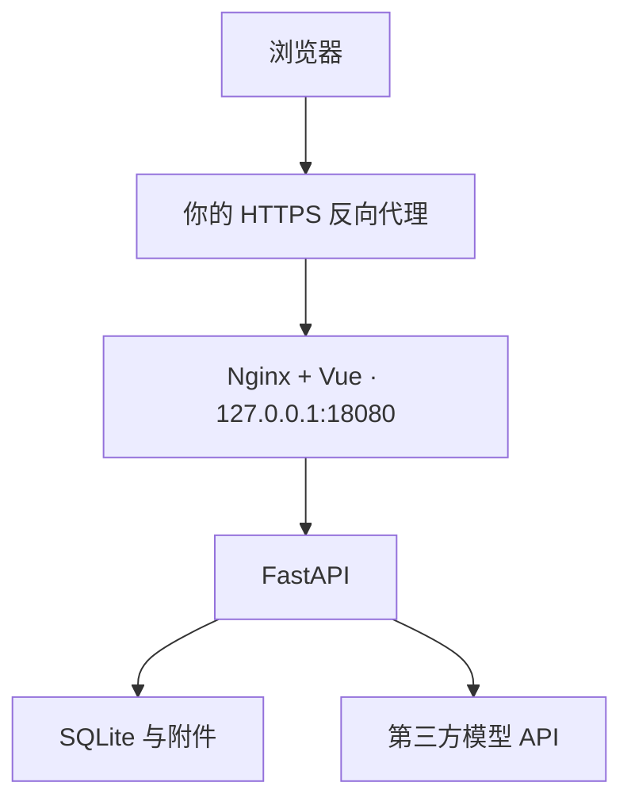

# FDE 学习工作台 v1.1

适合已有 PHP / Vue / 数据库 / DevOps 经验，计划以每周约 20 小时学习 AI 项目交付、独立提供技术服务的开发者。内置 **10 周、30 个任务、200 小时**的课程，围绕需求发现、AI 工程、评估、RAG、工具调用、部署和客户交付展开。

这是可自行部署的个人与小团队学习系统。课程引导你另建一个业务实践项目；学习平台负责教程、练习素材、提交、进度与反馈。已有 v1.0 部署请先阅读 **[v1.1 升级指南](docs/UPGRADE-v1.1.md)**，保留原 `.env` 与数据卷。

## 能做什么

- 首个管理员初始化；管理员创建多个学习者或管理员，管理状态、显示名和调用额度。
- 每个账号独立保存进度、作业、附件、评审与素材；初始或重置密码必须先修改，停用和重置会撤销旧会话。
- 学习总览、10 周路线、下一项任务、学习时间与进度记录。
- 每个任务含学习目标、教程、操作步骤、交付物、验收标准、评分量规和官方资料。
- 提交文字说明与附件，保留各次提交版本、静态检查结果和历史评审。
- 配置支持 **OpenAI 兼容 Chat Completions** 的第三方 AI 服务，保存后可测试连接。
- 根据课程任务、业务场景、技术栈和难度生成 AI 练习素材，按任务与版本整理，支持预览和单文件 / ZIP 下载。
- 作业可关联本人当前任务的素材版本，评审能够理解练习输入背景。
- AI 按课程量规给建议分、引用提交证据、说明缺失材料和下一步；总分由服务端根据分项分数计算。
- 评审进入持久队列，页面可离开后回来查看。失败会记录原因，不生成替代分数；重新评审由你主动发起。
- SQLite 与附件保存在 Docker 数据卷；提供备份和恢复脚本。

### 评分与验证的范围

AI 评审是学习反馈，不是考试认证或生产验收。系统不会执行上传的代码、打开提交中的链接、克隆仓库或核验远程环境。JSON 附件可以检查语法，Python 附件可以解析 AST；PHP / Vue 等代码会作为文本材料交给 AI 审阅。运行结果请附测试报告、命令与日志，仍需你核验其真实性。

模型输出须通过结构、评分项、分数范围、证据原文匹配等检查。即使引用匹配，也不能保证模型的判断正确。所有报告固定标明运行未验证。学习任务完成状态由你确认，不由某个分数自动决定。

## 部署准备

建议从一台 Linux 服务器开始；**2 核 / 2 GB 内存 / 10 GB 可用磁盘是起步建议，未做容量基准测试**。模型计算由你选择的外部服务承担。本机不需要 GPU。构建前端时如内存紧张，可增加内存或在另一台机器构建镜像。

需要 Docker Engine、Docker Compose 插件、Python 3（用于生成配置与备份脚本），以及一个指向服务器的子域名，如 `learn.example.com`。安装步骤请按 [Docker 官方文档](https://docs.docker.com/engine/install/) 和 [Compose 文档](https://docs.docker.com/compose/) 选择你的系统；本项目不包含会修改系统的安装脚本。

架构：



已有 PHP 项目可以与本系统共用服务器；本项目默认使用回环端口 18080，不占用宿主机 80 / 443。后端不直接发布到宿主机。

## 1. 启动应用

解压源码后进入目录：

```bash
cd fde-learning-system
python3 scripts/configure.py --domain learn.example.com
docker compose up -d --build
docker compose ps
```

把示例域名换成你的域名。配置脚本生成私有 `.env`，包含初始化令牌、加密主密钥、站点地址等。再次运行脚本会保留密钥，避免已有 AI Key 无法解密。

查看健康状态和必要日志：

```bash
curl -fsS http://127.0.0.1:18080/api/health
docker compose logs --tail=100 app web
```

如服务器上的 18080 已被占用，配置时加 `--port 18081`，同时修改下面反向代理的目标端口。

### 只在自己的电脑上试用

```bash
python3 scripts/configure.py --local
docker compose up -d --build
```

访问 `http://localhost:18080`。回环端口默认不能从另一台电脑访问；正式域名使用 HTTPS 配置。

## 2. 绑定域名与 HTTPS

将子域名的 A 记录指向服务器 IPv4。若配置 AAAA，也需要对应 IPv6 正常可达。选择你当前使用的反向代理即可，无须同时安装两套。

### 已有 Nginx、宝塔或其他面板

新增子站点，绑定域名和 HTTPS 证书，将请求反向代理到 `http://127.0.0.1:18080`。保留原始 Host，并传递 `X-Forwarded-Proto`。上传限制建议至少 10 MB，代理读取超时 150 秒。

`deploy/nginx-host.conf.example` 提供可参考的站点配置。它使用示例证书路径，必须替换为你的实际路径后才可启用；不要覆盖已有其他站点配置。

### 使用 Caddy

`deploy/Caddyfile.example` 的核心配置如下：

```caddyfile
learn.example.com {
    encode zstd gzip
    reverse_proxy 127.0.0.1:18080
}
```

将它加入宿主机 Caddy 的配置并按现有方式重载。域名解析正确且 80 / 443 可达时，Caddy 可管理证书签发和续期，详见 [Automatic HTTPS](https://caddyserver.com/docs/automatic-https)。如果 80 / 443 已由现有 Nginx 或面板使用，直接使用现有代理。

## 3. 首次开通账号

在你自己的服务器终端查看初始化令牌：

```bash
python3 scripts/show_setup_token.py
```

打开站点，填写初始化令牌、用户名和至少 12 位密码，创建首个管理员。初始化入口随后关闭。管理员在“用户管理”中创建其他账号；不开放公众自行注册。

新增账号和被重置密码的账号，首次登录后必须修改初始密码。管理员可停用账号、调整每日评审和素材额度。各账号学习数据相互隔离，管理员的日常学习页也只显示本人的记录；用户管理仅展示账号与汇总计数。

令牌不显示在公开接口中。令牌、账号密码、`.env` 和模型 Key 都不应粘贴到公开聊天或仓库。

## 4. 配置第三方 AI

管理员登录后进入 **AI 设置**，填写服务名称、Base URL、模型标识和 API Key，先保存再测试连接。学习者共享该模型服务，只能查看服务状态、模型与额度，不能查看 Base URL 或修改配置。测试会发出一个很小的真实 API 请求，可能产生少量服务方费用。

评分默认最多输出 3000 tokens；素材生成有独立的 `material_max_tokens`，默认 6000。输入很长或选多种素材时，模型可能截断 JSON；系统会将其标为失败，不保存半成品。可以缩小请求或使用支持足够输出长度的模型。

兼容范围是带 Bearer Key 的 `POST /chat/completions` 文本接口：

- Base URL 可填服务商文档指定的 API 基地址，程序追加 `/chat/completions`；也可填写完整的 `/chat/completions` 地址。
- 请求使用 `messages`、`model`、`temperature`、`max_tokens`、`stream:false`。
- 响应应包含 `choices[0].message.content` 字符串。
- 评审内容要求模型输出指定 JSON。没有使用专有的结构化输出参数，所以兼容服务仍须有足够的指令遵循能力。
- Azure 的专有部署路由、只支持 Responses 或原生 Messages 的接口、需要额外签名/请求头的网关，不能直接保证兼容。可通过你控制的兼容网关接入。

例如 [DeepSeek 官方 Chat Completions 文档](https://api-docs.deepseek.com/api/create-chat-completion/) 展示了同类接口形状；请以你的服务商当前文档为准。系统没有预置密钥，也不硬编码某个模型名称、价格或充值入口。

Key 只在后端加密保存，前端只收到“是否已配置”。加密主密钥来自 `.env` 的 `APP_MASTER_KEY`；备份时必须保留它。加密并不等于防御已完全控制服务器的攻击者。

默认允许公网 HTTPS 地址，拒绝回环、私网和保留地址，不跟随重定向。若你明确要连接自己的内网模型，在 `.env` 的 `AI_PRIVATE_HOST_ALLOWLIST` 中列出精确主机名，再重建应用容器，例如：

```dotenv
AI_PRIVATE_HOST_ALLOWLIST=llm.internal.example
```

Docker 容器中的 `localhost` 指容器自身。需要访问宿主机模型时，请根据你的 Docker 网络配置选择可达主机名；不要为解决连通性而允许任意内网地址。

## 5. 学习与作业流程

1. 从总览进入下一项任务，阅读教程和官方资料。
2. 在任务的素材区域生成所需的模拟案例、数据或文档；也可以使用你已有的合法练习材料。
3. 在你自己的开发目录完成业务项目，按任务的操作步骤保留代码、输入样本与结果。
4. 对照交付物和验收标准填写作业正文，附上可复现命令、关键日志、评估结果或设计说明；需要时选择使用的素材版本。
5. 提交后先查看静态检查与附件提取说明。每次提交保存新版本，不覆盖旧版本。
6. 在确认提示后发起 AI 评审；所选版本的正文、证据说明、附件提取文本、课程要求，以及关联素材背景会发送给管理员配置的服务商。
7. 根据反馈修改并再次提交，比较历史版本。你可以记录实际学习时长，并自行标记任务完成。

只提交不会自动调用模型。链接不会被自动访问；如果只提交仓库 URL，AI 看不到仓库代码。请提交必要的代码文件和说明，不要将生产密钥、客户个人信息或无权分享的材料作为作业。

### AI 素材库

在“素材库”选择课程任务，填写业务场景、难度、技术栈及附加要求，勾选需要的类型，再确认生成。系统会发送当前任务要求和填写的参数给第三方模型。请求进入持久队列，可以离开页面后回来查看。

| 类型 | 示例用途 |
| --- | --- |
| 业务案例 | 需求访谈、客户背景、业务约束和验收讨论 |
| 样例数据 | 模拟工单、订单、产品目录、JSON / CSV 数据 |
| 知识文档 | RAG 练习用的模拟政策、说明书与FAQ |
| 测试用例 | 需要你运行并核验的输入、边界条件与预期 |
| 起步模板 | 带 TODO 的文档或代码文本框架 |

一个素材包包含 1–8 个文件，每文件最多 10,000 字符，总计最多 40,000 字符。支持 Markdown、TXT、JSON、CSV、YAML 和 SQL；代码示例可放在 Markdown 内。系统检查 JSON/CSV 格式、路径、大小等，并将素材固定标为“AI 合成、运行未验证”。

重新生成会创建新版本，旧包继续保留。ZIP 内有 `manifest.json`，记录任务、版本、模型、生成参数、时间及文件哈希。素材只能由所属账号读取，当前版本没有共享素材功能。

素材是练习输入，不是已完成的作业。关联后，评分将它作为独立背景；生成的内容不会自动成为你的运行证据。系统不会执行生成的 SQL 或代码，也不会核验知识文档的真实业务事实。

### 附件与输入限制

| 项目 | 当前规则 |
| --- | --- |
| 正文 / 证据说明 | 最多 60,000 / 10,000 字符 |
| 附件数量 / 大小 | 最多 5 个；单个 2 MiB；总计 8 MiB |
| 文本代码 | txt、md、py、php、js、ts、tsx、jsx、vue、json、csv、yaml、yml、sql、sh、html、css、log；UTF-8 编码 |
| PDF / DOCX | PDF 前 30 页的可复制文字，DOCX 正文；不识别图片，不做 OCR |
| 提取范围 | 每附件最多 30,000 字符；一次评审总证据最多 90,000 字符，超出会标注截断 |
| 代码验证 | JSON 解析、Python AST；其他代码按文本评审，均不执行 |
| 评审队列 | 每用户最多 3 个排队或运行任务，全站最多 20 个；评审线程依次处理 |
| 素材队列 | 每用户最多 3 个、全站最多 20 个排队或运行任务；素材线程依次处理 |
| 每日 AI 调用 | 全站默认 30 次评审、30 次素材生成；新学习者默认 10 / 5，管理员可调整用户额度 |
| 额度重置 | 按 UTC 日计数，北京时间每天 08:00 重置；失败请求也计入额度 |

输入较长时，请根据服务商模型的上下文窗口主动缩小提交范围。字符上限不保证适合所有模型，也不等同于 token 数。

## 数据、备份、恢复与升级

默认卷为 `fde-learning_fde_data`（Compose 项目名改变时，前缀也会改变），其中包含 `learning.sqlite3` 和附件 `uploads/`。不要删除数据卷来升级。

### 备份

```bash
python3 scripts/backup.py
```

脚本会短暂停止后端、备份数据卷和 `.env`，随后恢复原有运行状态。正在处理的评审或素材生成若被中断，重启后会标记失败，需要手动重新发起。结果在 `backups/时间戳/`。请将整个目录加密备份到另一处，避免服务器丢失时连备份也丢失。

升级前使用 `python3 scripts/backup.py --keep-stopped`：成功后保持后端停止，防止升级前备份之后继续写入；失败时恢复原有容器，不会意外运行新镜像。脚本会拒绝未找到原项目容器的情况，避免误备份一个新建空卷。

### 恢复到新部署

恢复脚本只允许 **空数据卷** 和 **没有 `.env` 的新解压目录**，不会覆盖正在使用的数据。新目录本身不会改变 Compose 数据卷名称：若同一服务器还保留旧部署，必须指定新项目名和新端口。

```bash
cd 新解压目录/fde-learning-system
python3 scripts/restore_empty_volume.py /绝对路径/备份目录
python3 scripts/configure.py --domain learn.example.com
docker compose up -d
```

脚本验证备份路径、复制原有密钥、构建镜像并导入空卷；不自动启动站点。恢复成功后先检查账号、历史提交和 AI 设置，再处理旧部署。

若在同一服务器上与旧部署并存，请改用以下流程。项目名会保存在新 `.env` 中，之后的 Compose 命令会继续使用它。正式切换时再调整你的反向代理。

```bash
cd 新解压目录/fde-learning-system
python3 scripts/restore_empty_volume.py /绝对路径/备份目录 --project-name fde-learning-restore
python3 scripts/configure.py --domain learn.example.com --port 18081
docker compose up -d
```

### 升级

完整命令见 **[v1.1 升级指南](docs/UPGRADE-v1.1.md)**。推荐在新代码目录复制原 `.env`，确认同一 Compose 项目名，先 `docker compose build`，再用新版备份脚本 `--keep-stopped` 备份，最后 `docker compose up -d`。

首次启动会自动把旧账号设为管理员，并将原进度和作业归属于该账号。迁移前另建 SQLite 备份；事务失败会回滚。旧会话将失效，使用原密码重新登录。若需要回退，必须同时使用旧代码和升级前完整数据备份，不能直接让 v1.0 连接多用户数据库。

课程文件位于 `course/curriculum.json`。可以编辑教程、链接和量规；保留已有 task id 以保持进度关联。每个提交保存当时课程任务快照，历史提交再次评审使用其原量规。

## 本地开发

建议 Node.js 24 LTS、Python 3.12。下面流程不用 Docker：

```bash
python3 -m venv .venv
.venv/bin/pip install -r backend/requirements-dev.txt
npm --prefix frontend ci
npm run dev
```

默认前端 `http://localhost:5173`，后端监听回环 `8000`，Vite 转发 `/api`。本地数据与随机开发密钥位于 `.local/`，不应提交。开发用初始化令牌可在你自己的终端从 `.local/dev-secrets.json` 的 `setupToken` 字段读取；与正式 `.env` 令牌不同。

```bash
python3 scripts/validate_course.py
cd backend
../.venv/bin/python -m pytest
```

另开终端在项目根目录构建前端：

```bash
npm run build
```

在项目根目录运行完整测试（含数据库迁移、多账号隔离、素材队列、部署配置和真实课程集成）：

```bash
PYTHONPATH=backend .venv/bin/python -m pytest -q backend/tests tests
```

API 合同见 `backend/README_API.md` 和 `backend/MATERIALS_API.md`，本次交付的实际检查结果见 `docs/VERIFICATION.md`。

## 版本范围

v1.1 面向个人及小团队：管理员创建账号、一套内置课程、私有学习空间、AI 素材与文本评审、手动进度确认。没有公开注册、邮件找回密码、班级教学管理、支付、素材共享、自动 GitHub 拉取、代码沙箱或真实线上验收。

当前部署使用一个应用实例和一个 Uvicorn 进程，内部各有一个评审与素材线程。扩展为多实例需要改造任务队列和数据库方案；没有多用户容量基准结果。

代码组织：`frontend/` 是 Vue 3 + TypeScript；`backend/` 是 FastAPI；`course/` 是课程数据；`deploy/` 是容器与反向代理配置；`scripts/` 是本机和部署辅助工具。你已有的 PHP / Vue 经验会在课程业务项目中继续使用，不需要为了使用本平台先重写自己的项目。
